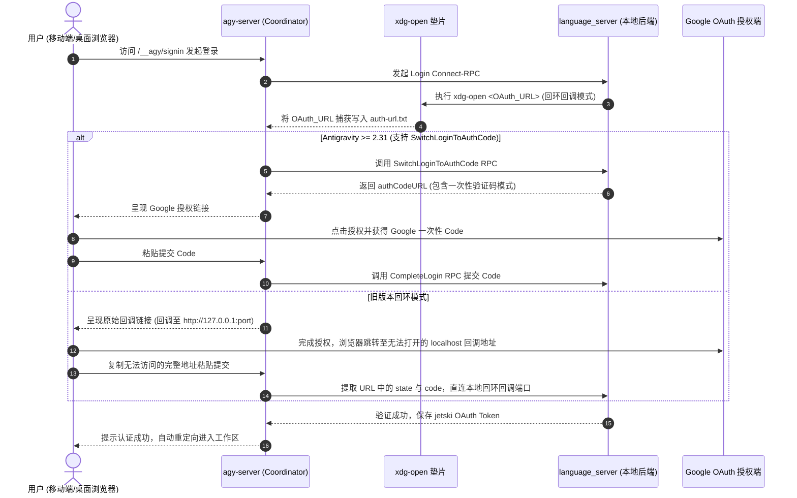

# Antigravity Server 深度架构与实现原理分析

> **版本分析基准**: `v0.2.65` (最新发布 Tag)  
> **源码位置**: `antigravity-server/`  
> **核心定位**: Google Antigravity 的自托管反向代理与移动端体验优化守护服务（Self-hosted Proxy & Supervisor）

---

## 目录
1. [系统总体架构](#1-系统总体架构)
2. [底层核心：进程管控与生命周期 (internal/lsproc)](#2-底层核心进程管控与生命周期-internallsproc)
3. [运行时动态补丁引擎 (internal/patches)](#3-运行时动态补丁引擎-internalpatches)
4. [代理、协议转换与 WebSocket 压缩中继 (internal/proxy)](#4-代理协议转换与-websocket-压缩中继-internalproxy)
5. [远程 Google OAuth 认证协调 (internal/signin)](#5-远程-google-oauth-认证协调-internalsignin)
6. [分块流式大文件上传机制 (internal/upload)](#6-分块流式大文件上传机制-internalupload)
7. [安全性与会话管理 (internal/auth)](#7-安全性与会话管理-internalauth)
8. [零停机自动更新与每日内存维护 (internal/updater)](#8-零停机自动更新与每日内存维护-internalupdater)
9. [Rules & Skills 在线编辑器 (internal/rules)](#9-rules--skills-在线编辑器-internalrules)
10. [总结与架构精髓](#10-总结与架构精髓)

---

## 1. 系统总体架构

Google Antigravity 内部包含一个独立的二进制程序 `language_server`。当它以 `--standalone` 参数运行时，会在本地回环端口（127.0.0.1）提供完整的 Web 界面和 Connect-RPC / gRPC-Web 服务。但官方构建存在以下局限：
1. **触屏与移动端无法使用**：桌面 Web 资源包未对触控、虚拟键盘（iOS Visual Viewport）、CJK 输入法（IME）换行等做适配，甚至隐藏了新建对话、删除对话等核心功能。
2. **直连与无头运行困难**：在没有桌面环境（X11/Wayland）的云主机上，官方 OAuth 依赖调用本地桌面浏览器 `xdg-open`，导致云端登录流程断裂。
3. **缺乏访问控制**：官方仅依赖本地回环或 Google 远程桥接，无独立的密码保护与会话管理。
4. **网络传输瓶颈与断连问题**：WebSocket 不支持压缩，导致长会话大 JSON 传输超时；服务重启后 CSRF Token 失效，前端遭遇 502 陷入死循环。

`agy-server` 采用 **透明代理 + 运行时热补丁 + 进程监管** 的整体设计，站在 Google 官方 `language_server` 前端，提供双模运行机制：

```
                      +------------------------------------------------+
                      |         客户端浏览器 / 移动端 PWA / 桌面           |
                      +-----------------------+------------------------+
                                              | HTTPS / WSS
                                              v
                      +------------------------------------------------+
                      |      反向代理 (Nginx / Caddy，可选开启 TLS)      |
                      +-----------------------+------------------------+
                                              | HTTP / WS (Port: 8765)
                                              v
+-------------------------------------------------------------------------------+
|                             agy-server (Go 主进程)                            |
|                                                                               |
|  +--------------------+   +-----------------------+   +--------------------+  |
|  |   auth (中间件)     |-->|   proxy (反向代理)     |-->|   patches (补丁)   |  |
|  | PBKDF2/Cookie/限流  |   | ETag缓存/流式/gRPC转换|   | 61项JS/HTML热重写  |  |
|  +--------------------+   +-----------+-----------+   +--------------------+  |
|                                       |                                       |
|  +--------------------+   +-----------v-----------+   +--------------------+  |
|  | upload (大文件分块) |   | wsrelay (WebSocket)   |   | signin (OAuth拦截) |  |
|  | 突破 1MB RPC 限制  |   | 上下文压缩/保活心跳   |   | xdg-open 垫片/代办 |  |
|  +--------------------+   +-----------+-----------+   +--------------------+  |
|                                       |                                       |
|  +------------------------------------v------------------------------------+  |
|  |                 lsproc (Language Server 进程管控与调度)                  |  |
|  |          /proc 端口发现 · CSRF 持久化 · 每日维护重启 · 日志轮转          |  |
|  +------------------------------------+------------------------------------+  |
+---------------------------------------|---------------------------------------+
                                        | Loopback (127.0.0.1:RandomPort)
                                        v
+-------------------------------------------------------------------------------+
|                      Google Antigravity language_server                       |
|                 (原生二进制程序，运行于 --standalone 模式)                   |
+-------------------------------------------------------------------------------+
```

---

## 2. 底层核心：进程管控与生命周期 (`internal/lsproc`)

### 2.1 无特权、纯系统级进程发现与端口嗅探
在 Linux 环境下，`language_server` 在随机端口启动监听，且不写入 PID 文件。`agy-server` 避免依赖外部命令（如 netstat、fuser）实现极低开销的发现机制：
1. **遍历 `/proc` 文件系统**：读取各进程的 `/proc/<pid>/cmdline`，匹配包含 `language_server` 和 `--standalone` 的进程。
2. **Inode 级端口映射 (`discover_unix.go`)**：
   - 读取 `/proc/<pid>/fd/` 目录，找出指向 `socket:[<inode>]` 的符号链接，收集该进程占用的所有 Socket Inode。
   - 读取 `/proc/net/tcp` 与 `/proc/net/tcp6`，过滤状态为 `0A` (即 `TCP_LISTEN`) 的记录，将对应的 Socket Inode 与 hex 端口转换为真实端口号。
3. **Web UI 探针确认 (`servesWebUI`)**：
   - 由于语言服务器可能同时打开内部通信端口，`agy-server` 发送 HTTPS GET 请求嗅探该端口根路径，忽略自签名证书，读取前 8KB 响应头，确认包含 `__APP_CONFIG__` 标记，锁定真正的 Web 服务端口。

### 2.2 CSRF Token 持久化与会话防中断
`language_server` 要求所有状态变更 RPC 携带请求头 `x-codeium-csrf-token`。
- 原生问题：若语言服务器重启，默认会重新生成随机 Token，导致所有已连接网页由于 CSRF 校验不一致而被拒绝。
- 解决机制：`agy-server` 在云端启动时生成随机 UUID 写入 `csrf-token.txt`（权限 `0600`），并通过命令行参数 `--csrf_token <token>` 显式注入启动命令。重启时优先复用该文件，实现**跨重启无感重连**。

### 2.3 浏览器伪装垫片 (Browser Shim)
在无头服务器执行 OAuth 登录时，`language_server` 会直接调用系统 `xdg-open <url>`。
- `agy-server` 在独立的临时目录下创建可执行脚本 `xdg-open`，并将该目录追加到 `language_server` 运行环境变量的最前端 (`PATH=<shim>:$PATH`)。
- 当 `language_server` 触发 `xdg-open` 时，垫片脚本将重定向 URL 追加保存到 `auth-url.txt`，供 Web 认证服务提取。

---

## 3. 运行时动态补丁引擎 (`internal/patches`)

由于 Google `language_server` 内置的 Web UI 静态包是经过编译与混淆压缩的单个庞大单页应用（`main.js` 约 9MB），`agy-server` 设计了一套**声明式精确热补丁引擎**。

### 3.1 补丁架构设计
- **补丁分类**：
  - `Literal`：精确字面量单次替换，高效稳定。
  - `Regexp`：正则匹配替换，支持命名捕获组与动态函数计算 (`ReplaceMatch`)。
  - `InjectHead`：在 HTML 响应的 `</head>` 标签前注入内联脚本与样式。
- **缓存一致性保证 (`CacheKey`)**：
  计算版本号、工作区路径、各补丁 ID 与替换内容的 SHA-256 哈希作为 `CacheKey`。一旦补丁规则或服务端版本变更，主页面加载的 `/main.js?agy=<hash>` 立即刷新，强制浏览器拉取新包，彻底防止旧补丁缓存。
- **内存预热机制 (`Prewarm`)**：
  服务器启动时立即在后台向本地回环端口拉取原生 `main.js`，执行 61 个补丁替换并缓存在内存中。第一个终端用户访问时可享 **0ms 等待** 直接命中缓存。

### 3.2 关键补丁分类解析（共 61 项补丁）

| 分类 | 代表性 Patch ID | 解决的核心问题与技术实现 |
| :--- | :--- | :--- |
| **移动端触控 UX** | `touch-action`<br>`mobile-user-message-actions`<br>`mobile-kebab-menu-pin-archive` | 注入 `touch-action: manipulation` 消除 300ms 点击延迟；在消息气泡上常显撤销与复制；在列表 kebab 菜单中补全移动端缺失的删除、置顶、归档能力。 |
| **虚拟键盘与视口** | `keyboard-detect`<br>`safe-area-insets`<br>`mobile-enter-newline` | 实时跟踪 iOS `window.visualViewport` 变化，软键盘弹起时动态将底部 Safe Area 压缩为 0px 并防止顶部视口错位；修复 Lexical 编辑器在 CJK 输入法未上屏时回车误发送的问题。 |
| **长列表平滑滚动** | `autoscroll-distance-fix`<br>`paging-trim-waits-for-still`<br>`scrollbar-drag-follows-paging` | 官方 Web 端在移动端长对话向上滚动加载历史记录时，会陷入频繁收缩高度导致的无休止重复请求雪崩；补丁通过输入追踪器锁定滚动锚点，阻止级联请求。 |
| **网络与连接稳定性** | `websocket-transport-default`<br>`websocket-liveness-probe-relax`<br>`connection-watchdog`<br>`user-status-keep-on-error` (最新 v0.2.65) | 默认启用 WebSocket 代替易在 iOS Safari 挂起的 fetch 流；心跳超时由 2s 放宽到 30s；看门狗检测卡死自动重连；**v0.2.65 重点修复**：当后台休眠唤醒导致轮询 `getUserStatus` 失败时，保留已加载模型列表并采用指数退避重试，避免重置模型状态。 |
| **文件流式上传** | `file-upload-large-file-streaming-fallback`<br>`file-upload-accept-all` | 拦截前端原生 1MB 上限的 RPC 上传调用，透明重定向到 `agy-server` 的分块流式上传端点。 |
| **远程认证与设置** | `base-url-origin`<br>`sign-in-button`<br>`settings-restore-customizations-tab` | 修正原生写死的 `127.0.0.1` 基础路径；将失效的登录按钮重定向到服务端 Web 认证页；在移动端强制恢复 Customizations 标签页。 |

---

## 4. 代理、协议转换与 WebSocket 压缩中继 (`internal/proxy`)

### 4.1 智能流式反向代理
- **实时刷新与无缓冲 (`rp.FlushInterval = -1`)**：Antigravity 的智能体输出依赖 Server-Sent Events (SSE) 和分块传输，代理层彻底关闭响应缓冲，确保文字逐字流式打字输出。
- **条件缓存与 ETag 协商**：针对补丁后的 `main.js` 生成 SHA-256 ETag。客户端带 `If-None-Match` 访问时，直接返回 `304 Not Modified`，避免反复下载 9MB 资源包。
- **静态资源长期缓存**：针对 CSS、WebAssembly、字体、图标等非补丁资源自动注入 `stale-while-revalidate`，提升二次访问秒开体验。

### 4.2 gRPC-Web 状态码 14 转换（优雅容灾）
当语言服务器因为自动更新、空闲维护重启或短时失联时：
- 传统代理会向浏览器返回 HTTP `502 Bad Gateway`（HTML 格式），导致前端报错崩溃；
- `agy-server` 的 `errorHandler` 拦截此类请求，当检测到客户端是 gRPC-Web 流量时，**伪装返回 HTTP 200 + `grpc-status: 14` (Unavailable)**，前端 SDK 收到标准不可用信号后会自动进入退避重试循环，在后端启动就绪后**无刷新自动恢复连接**。

### 4.3 WebSocket 上下文压缩中继 (`wsrelay.go`)
1. **跨域握手安全校验 (`sameOriginUpgrade`)**：
   WebSocket 请求不走传统浏览器 CORS 限制。代理层严格比对请求头 `Origin` 与客户端的 `Host` / `X-Forwarded-Host` / `public-url`，防范恶意网站发起跨站劫持连接。
2. **解决原生未压缩瓶颈**：
   官方语言服务器不支持 `permessage-deflate`，对于复杂会话，初始全量会话树 JSON 可能高达数十兆，在移动蜂窝网络下传输极易触发超时。
3. **上下文接管压缩 (`CompressionContextTakeover`)**：
   `agy-server` 自行终结与客户端的 WebSocket 握手，开启 `websocket.CompressionContextTakeover` 滑动窗口压缩，将上游未压缩的大体积 JSON 压缩 70%~85% 后推送给手机端，显著降低网络延迟。

---

## 5. 远程 Google OAuth 认证协调 (`internal/signin`)

在无桌面界面的远程服务器上，Google 账号登录是最大痛点。`internal/signin` 实现了优雅的远程授权中继：



---

## 6. 分块流式大文件上传机制 (`internal/upload`)

官方 Antigravity 默认采用 Connect RPC 传输文件，受制于 1MB 单包上限，无法直接上传大型日志、HAR、音视频或测试数据集。

### 6.1 分块与流式写入架构
- **端点**：`POST /__agy/api/upload`
- **前端分块**：JS 补丁拦截文件上传事件，大于 1MB 的文件被切分为固定分块，附带 `uploadId`、`chunkIndex`、`totalChunks`、`chunkOffset`。
- **原子追加与并发锁**：
  服务端使用 `partLock` 针对每个 `uploadId` 进行分段加锁，分块内容直接流式追加写入临时文件 `.agy_part_<uploadId>`。全部块到达后原子重命名到目标目录。
- **目录隔离与安全防线**：
  - 上传路径被强制限制在项目的 `.agy_uploads/` 目录下。
  - 使用 `filepath.Clean` 严格过滤 `../` 路径穿越攻击。
  - 后台启动 Cleaner 定时轮询，删除超过 7 天（`DefaultTTL`）的历史上传文件，避免服务器磁盘爆满。

---

## 7. 安全性与会话管理 (`internal/auth`)

1. **密码学安全认证**：
   - 用户密码采用 **PBKDF2-SHA256** 哈希算法，迭代轮数高达 **200,000 次**，配置独立随机盐（Salt 16 字节），防范彩虹表与硬件暴力破解。
   - 首次启动随机生成人类易读的短语密码（如 `xxxx-xxxx-xxxx`），剔除易混淆字符。
2. **会话令牌 (Session Store)**：
   - 浏览器端下发 256 位加密随机 Token，服务端磁盘持久化存储其 **SHA-256 哈希值**。即使用户会话文件泄露，也无法反推明文 Cookie。
   - 支持设置会话有效期（默认 30 天），支持随时通过命令行撤销特定或全部设备登录态 (`agy-server sessions revoke`)。
3. **防暴力破解指数退避 (`Limiter`)**：
   - 限制每个 IP 在时间窗口内的错误尝试次数。连续失败 5 次触发封禁，惩罚时间以指数增长（1min、2min、4min... 最高 30min）。
4. **受信任代理 IP 校验 (`TrustedProxies`)**：
   - 解析真实访客 IP 时，仅在请求来自于配置的 CIDR（如 `127.0.0.1/32`）时才信任 `X-Forwarded-For`，防止外部恶意伪造来源 IP 绕过限流封禁。

---

## 8. 零停机自动更新与每日内存维护 (`internal/updater`)

Antigravity 语言服务器在长时间高负载会话下，内存容易膨胀（可累积达 4GB+）。`agy-server` 在云端服务模式（`serve`）下实现了全自动化运维：

1. **GCS 官方版本发现与校验**：
   后台守护任务每日轮询 Google 官方存储桶页面（`https://antigravity.google/download`），校验 URL 白名单，提取匹配架构（`linux-x64`、`linux-arm` 等）的最新构建。
2. **原子文件替换**：
   下载官方构建后，在目标路径同目录下写入临时文件并 `os.Rename` 原子覆盖，防止下载中断损坏二进制文件。
3. **每日空闲安全重启 (Daily Idle Maintenance)**：
   - 依赖 `Proxy.IsIdle(15 * time.Minute)`：检查当前活跃长连接数是否为 0，且距上次网络活动是否已超 15 分钟。
   - 若服务器繁忙，延后 10 分钟重试（最多重试 6 次）；
   - 在无任务空闲窗口安全触发 `SIGTERM` 重启语言服务器，内存瞬间从几个 GB 降回到基准的 ~450MB，且因为前端 gRPC 状态转换与持久化 CSRF Token，用户页面无需刷新、完全无感知。

---

## 9. Rules & Skills 在线编辑器 (`internal/rules`)

为了方便移动端和远程用户实时调整 Agent 规则，无需频繁通过 SSH 登录修改文件：
1. **端点暴露**：
   - `GET /__agy/api/rules/read?path=...`
   - `POST /__agy/api/rules/save`
2. **目录白名单与安全校验**：
   - 严格限定仅能读写 `~/.gemini`、`~/.agents`、`~/.agent` 以及配置的 `workspaceRoot` 目录。
   - 自动识别目录中的 `SKILL.md` 和 `GEMINI.md`。
3. **原子保存机制**：
   通过 `os.CreateTemp` 生成带权限控制的临时文件，刷盘 (`Sync`) 后通过系统级 `Rename` 原子替换目标规则文件，确保编辑过程不会因断电或网络中断损坏配置文件。

---

## 10. 总结与架构精髓

`antigravity-server` 展现了高水准的反向工程与系统编程实践：

1. **非侵入式（Non-invasive）**：不修改 Google 官方闭源二进制文件，直接消费官方 GCS 发布的发行包，避免版权与分发合规问题。
2. **热补丁与流式代理融合**：利用 Go 高性能网络栈在运行时动态修改混淆的 JS 资源包，既解决了移动端适配与 61 处交互痛点，又通过预热与 ETag 缓存保留了极高访问性能。
3. **协议级无缝衔接**：深入理解 gRPC-Web、Connect-RPC、WebSocket 压缩协议与 CSRF 验证机制，做到了跨服务重启的**无刷新自动重连**。
4. **全自研极简运维**：集成 `/proc` 端口嗅探、OAuth 垫片拦截、大文件分块流、PBKDF2 认证、自动更新与空闲内存重置，真正做到了廉价 Linux VPS 上的长期无人值守运行。
